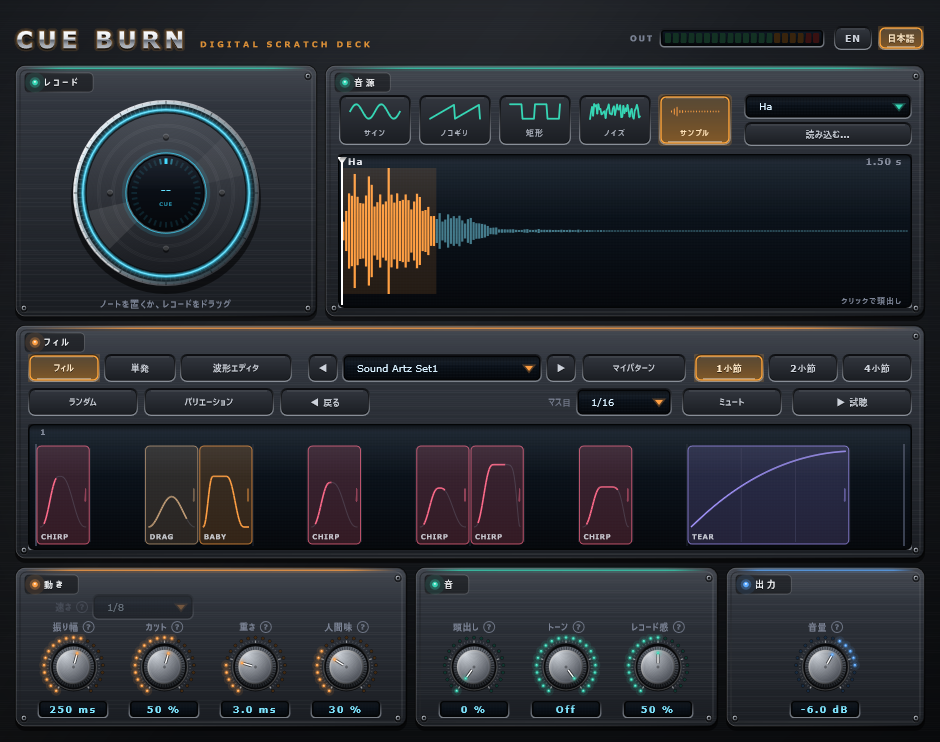

# Cue Burn

FL Studio (および VST3 に対応する他の DAW) 用の、無料のスクラッチ楽器プラグインです。

ピアノロールにノートを置くだけで、DJ のスクラッチのフレーズが鳴ります。ブロックを並べてフレーズを組み立て、カーブや音の終わりまで細かく作り込めます。



**Windows 64bit / FL Studio で動作確認しています。macOS には対応していません。FL Studio 以外の DAW での動作は未確認です。**

*English: Cue Burn is a free turntable-scratch instrument (VST3, Windows 64-bit). Place a note and it plays a scratch phrase built from editable blocks. The UI is available in English and Japanese. Tested in FL Studio only.*

## ダウンロード

[Releases](../../releases/latest) から `CueBurn-vX.Y.Z-win64.zip` をダウンロードしてください。

## インストール

1. zip を展開します。
2. `Cue Burn.vst3` フォルダを `C:\Program Files\Common Files\VST3\` にコピーします。
3. FL Studio の Options → Manage plugins で **Find installed plugins** を実行します。
4. チャンネルラックに、楽器 (ジェネレーター) として読み込みます。

コード署名を行っていないため、Windows の SmartScreen やウイルス対策ソフトが警告を表示することがあります。ソースコードは本リポジトリで全て公開しています。

## 使い方

1. 右上の一覧からサンプルを選びます (声・ホーン・オケヒットなど 27 種)。読み込む… ボタンや、ファイルのドラッグ&ドロップで自分の音も使えます。
2. 「フィル」の一覧からテンプレートを選びます。起動時は空なので、マスをクリックしてブロックを置いても構いません。
3. ピアノロールにノートを置きます。ノートの高さで音程が変わります。

### 3つのモード

| モード | 内容 |
|---|---|
| フィル | ブロックを並べたフレーズを鳴らします |
| 単発 | 1つのパターンを、ノートの間くり返します |
| 波形エディタ | パターンのカーブそのものを、点と曲がり具合で編集します |

### ブロックの操作 (フィル)

| 操作 | 内容 |
|---|---|
| クリック / Shift+クリック / ホイール | パターンを次へ / 前へ |
| 横にドラッグ | ブロックを移動 |
| 上下にドラッグ | そのブロックの振り幅 |
| 右端・左端をドラッグ | ブロックの長さ |
| ◇ を上下にドラッグ | そのブロックだけカーブを曲げる (上り・下りを別々に) |
| ▼ を左右にドラッグ | そのブロックの音の終わりを、短く・長くする |
| 右クリック | 速さ・高さの変更、波形の編集、削除など |
| 空いているマスをクリック / ドラッグ | パターンを追加 |

「ミュート」をオンにしてなぞると、ブロックの一部だけ音を消せます。ランダム、バリエーション、マス目 (1/16・1/32・3連符) も使えます。

### マイパターン

「マイパターン」ボタンから、作ったフレーズを名前を付けて保存できます。テンプレートの一覧や ◀▶ から、どのプロジェクトでも呼び出せます。音源とノブは変わりません。保存先は `%APPDATA%\Sound Artz\Cue Burn\MyPatterns` です。

### ノブ

| パネル | ノブ | 内容 |
|---|---|---|
| 動き | 振り幅 / カット / 重さ / 人間味 | レコードを動かす幅、フェーダーで切る強さ、手の重さ、タイミングや強さの揺れ |
| 音 | 頭出し / トーン / レコード感 | サンプルの開始位置、音色、レコードの擦れやノイズ |
| 出力 | 音量 | 全体の音量 |

レコードをマウスでドラッグして、直接スクラッチすることもできます。各項目の **?** にカーソルを合わせると説明が出ます。右上の **EN / 日本語** で表示言語を切り替えられます。

## 既知の制約

- macOS 版はありません。
- 他の DAW (FL Studio 以外) での動作は未確認です。

## ソースからビルドする

CMake と Visual Studio 2022 (Desktop development with C++) が必要です。[JUCE](https://github.com/juce-framework/JUCE) 8.0.4 はビルド時に自動で取得します。パスに日本語を含まないフォルダでビルドしてください。

```bash
cmake -B build -G "Visual Studio 17 2022" -A x64
cmake --build build --config Release --target CueBurn_VST3
```

## ライセンス

ソースコードは [GNU Affero General Public License v3.0](LICENSE) のもとで公開しています。

- ソースコードは自由に利用・改変・再配布できますが、AGPLv3 の条件 (改変版もソースを公開する、ネットワーク越しに提供する場合も対象になる、など) が適用されます。
- 本プラグインは [JUCE](https://juce.com) フレームワーク (GPL/AGPL ライセンス) を使用しています。

`Samples` フォルダのプリセットサンプルは AGPLv3 の対象外で、それぞれ次の条件です。

- **声**: [Sound Artz Voice Samples](https://github.com/soundartzix-netizen/voice-samples) から収録しています。条件は同リポジトリをご覧ください。
- **声以外 (ホーン・オケヒット・シンセ・808・ギター)**: Stable Audio 3 で生成した音です。楽曲制作に使えますが、Stability AI Community License により、生成 AI モデルの作成・改良 (学習など) には使えません。

## 無保証について

このソフトウェアは無保証で提供されます。動作によって生じたいかなる損害についても、作者は責任を負いません。自己責任でご使用ください。
